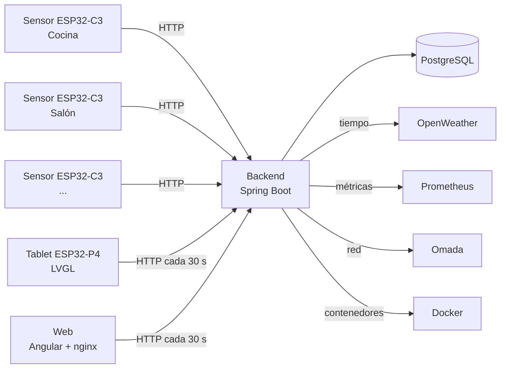

# bahguta Homelab

🇬🇧 [English](README.md) · 🇪🇸 Español


Panel de control para tu casa y tu homelab: una **tablet con ESP32-P4** que muestra en tiempo real la temperatura y humedad de cada habitación, el tiempo, el estado de tus contenedores Docker, la red y mucho más, alimentada por un **backend Spring Boot** y por **sensores ESP32-C3** a pilas repartidos por la casa.

El mismo panel está disponible también como **aplicación web** (Angular) que puedes abrir en cualquier navegador o instalar en el móvil.

Todo funciona en tu red local, sin nube y con tus propios datos.

> **Estado:** versión 1.0.0, en uso diario en mi casa. Es un proyecto personal que comparto con la comunidad: úsalo, adáptalo y mejóralo.

## Qué incluye

| Componente | Carpeta | Descripción |
|---|---|---|
| Backend | [`spring/`](spring/) | API REST con Spring Boot 3.5 (Java 21), PostgreSQL, Flyway y Swagger UI |
| Tablet | [`bahguta-display/`](bahguta-display/) | Firmware de la pantalla ESP32-P4 (800x1280, táctil) con interfaz LVGL |
| Web | [`bahguta_spa/`](bahguta_spa/) | PWA en Angular servida por nginx: las mismas pantallas en el navegador o en el móvil. Ver su [README](bahguta_spa/README.es.md) |
| Sensores | [`bahguta-firmware/`](bahguta-firmware/) | Firmware de los nodos ESP32-C3 con sensor DHT22 |
| Infraestructura | [`compose/`](compose/), [`config/`](config/) | Docker Compose de PostgreSQL (y un broker MQTT Mosquitto opcional, aún sin uso) y su configuración |
| Utilidades | [`scripts/`](scripts/) | Scripts auxiliares: arrancar/parar PostgreSQL y listar/arrancar/parar contenedores Docker |
| Documentación | [`docs/es/`](docs/es/) | Guías detalladas (API, base de datos, hardware, red, despliegue) |

## Qué hace la tablet

- **Casa:** plano de la casa con temperatura y humedad por habitación, y gráfico de histórico con una línea por habitación.
- **Tiempo:** tiempo actual y previsión por franjas, con iconos animados (OpenWeather).
- **Dispositivos y sensores:** estado de cada nodo, y cuándo envió su última medición.
- **Docker:** lista de contenedores del servidor, con arranque y parada desde la tablet.
- **Red y Grafana:** accesos y estado de la red y de tus paneles de monitorización.
- **Sistema:** estado del servidor.
- **Ajustes:** WiFi, URL del backend, zona horaria, intervalo de refresco y tiempo de inactividad, guardados en la memoria de la propia tablet.
- Transiciones suaves entre pantallas y apagado y encendido progresivo de la retroiluminación.
- Muestra la versión del proyecto que informa el backend.


Home Screen:


Weather Screen:


Casa Screen:


Docker Screen:


Devices Screen:


Config Screen:


Settings Screen:


Red Screen:


System Screen:


## Arquitectura



- Los **sensores** miden temperatura y humedad, se registran en el backend y envían sus mediciones por HTTP. Funcionan a pilas 18650 y duermen entre mediciones para ahorrar batería.
- El **backend** guarda las mediciones, gestiona dispositivos y sensores y agrega todo en un único JSON de dashboard.
- La **tablet** consulta ese dashboard periódicamente y dibuja la interfaz.
- La **web** hace lo mismo desde el navegador. Su nginx reenvía la API y añade él mismo la clave de Docker, así que la clave nunca llega al navegador.

## Hardware

- **Tablet:** placa ESP32-P4 con pantalla de 800x1280 y táctil GSL3680. Requiere el core de Arduino para ESP32 **v3.1**.
- **Sensores:** ESP32-C3 SuperMini con sensor DHT22 (humedad y temperatura), alimentados con pilas 18650.
- **Servidor:** cualquier máquina Linux con Docker (en mi caso, un mini PC).

Lista de piezas con enlaces, dónde lo compré todo y foto de un nodo terminado: [docs/es/HARDWARE.md](docs/es/HARDWARE.md).


## Puesta en marcha

### 1. Backend

Requisitos: Docker con Compose, Java 21 y Maven.

```bash
# 1. Variables de entorno
cd spring
cp .env.example .env
nano .env                       # contraseña de la BD, API key de OpenWeather, ciudad...

# Clave para los endpoints de Docker (la tablet necesita el mismo valor, ver paso 3)
echo "BAHGUTA_API_KEY=$(openssl rand -hex 32)" >> .env
docker ps --format '{{.Names}}' # elige qué contenedores se podrán arrancar/parar y añade
                                # DOCKER_ALLOWED=nombre1,nombre2 al .env (separados por comas, sin espacios)

# 2. Red de Docker y PostgreSQL
docker network create web       # solo la primera vez
mkdir -p ../data/postgres
cp ../config/postgres/.env.example ../config/postgres/.env
docker compose -f ../compose/postgres.yml up -d

# 3. Compilar y desplegar
bash make-proxy-template.sh     # plantilla del proxy de Docker (la primera vez y al actualizar su imagen)
mvn -f bahguta-api/pom.xml clean package -Dmaven.test.skip=true
cp bahguta-api/target/bahguta-api-*.jar bahguta-api.jar
docker compose up -d --build
```

La documentación de la API (Swagger UI) queda en `http://TU_SERVIDOR:8080/swagger`.

PostgreSQL y el backend comparten la red externa de Docker `web`, y así el backend resuelve el nombre `postgres`. La contraseña de `DB_PASSWORD` debe coincidir con `POSTGRES_PASSWORD` de `config/postgres/.env` (plantilla en `config/postgres/.env.example`).

### Variables de entorno

| Variable | Descripción | Por defecto |
|---|---|---|
| `DB_PASSWORD` | Contraseña de PostgreSQL (**obligatoria**) | - |
| `DB_USER` | Usuario de PostgreSQL | `bahguta` |
| `DB_URL` | URL JDBC | `jdbc:postgresql://postgres:5432/bahguta` |
| `PROMETHEUS_URL` | URL de Prometheus | `http://localhost:9090` |
| `WEATHER_API_KEY` | API key de [OpenWeather](https://openweathermap.org/api) | vacía |
| `WEATHER_CITY` / `WEATHER_COUNTRY` | Ciudad y país del tiempo | `Madrid` / `ES` |
| `OMADA_URL`, `OMADA_USERNAME`, `OMADA_API_PASSWORD` | Controlador TP-Link Omada (opcional) | vacías |
| `BAHGUTA_API_KEY` | Clave que exigen los endpoints que arrancan y paran contenedores (**obligatoria**). Genérala con `openssl rand -hex 32` | - |
| `DOCKER_ALLOWED` | Nombres de los contenedores que se pueden arrancar y parar, separados por comas y sin espacios (**obligatoria**) | - |

### 2. Sensores (ESP32-C3)

Requisitos: [PlatformIO](https://platformio.org/).

```bash
cd bahguta-firmware/bahguta-firmware
cp include/Config.example.h include/Config.h
# edita include/Config.h: WiFi, URL del backend, nombre y ubicación de la habitación
pio run -t upload
```

Cada sensor necesita su propio `Config.h` (nombre, ubicación e IP distintos). `Config.h` está en el `.gitignore`: nunca lo subas a un repositorio.

### 3. Tablet (ESP32-P4)

1. Instala el core de Arduino para ESP32 **v3.1** y las librerías que usa el proyecto (LVGL incluida; ver la carpeta `bahguta-display/`).
2. Copia `bahguta-display/bahguta_display/src/ui/Secrets.example.h` a `Secrets.h` en la misma carpeta y pon el mismo `BAHGUTA_API_KEY` que en el `.env` del backend. Sin él, arrancar y parar contenedores desde la tablet falla con `401`.
3. Abre `bahguta-display/bahguta_display/bahguta_display.ino`, compila y sube.
4. Sube la carpeta `data/` (iconos y animaciones del tiempo) al sistema de ficheros **LittleFS** de la tablet.
5. En el primer arranque, entra en **Ajustes** y configura el WiFi y la URL del backend (por ejemplo `http://bahguta.local`).

### 4. Web (opcional)

Requisitos: el backend en marcha y Docker.

```bash
mkdir -p /opt/bahguta/web && cd /opt/bahguta/web
cp ~/bahguta-homelab/bahguta_spa/docker-compose.example.yml docker-compose.yml
cp ~/bahguta-homelab/bahguta_spa/.env.example .env    # BACKEND_URL y el mismo BAHGUTA_API_KEY que el backend
printf 'admin:%s\n' "$(openssl passwd -apr1)" > htpasswd   # usuario y contraseña para el control de Docker
docker build -t bahguta-web:latest ~/bahguta-homelab/bahguta_spa
docker compose up -d
```

Guía completa (desarrollo, configuración y seguridad): [bahguta_spa/README.es.md](bahguta_spa/README.es.md).

## Seguridad: léelo antes de exponer nada

Este proyecto está pensado para una **red local de confianza**:

- La API **no tiene autenticación general**: cualquiera con acceso a la red puede leer sus datos. **No la expongas a internet.**
- Los endpoints que arrancan y paran contenedores están protegidos: exigen la cabecera `X-API-Key` y solo actúan sobre los contenedores de `DOCKER_ALLOWED`.
- El backend **no** monta `/var/run/docker.sock`. Habla con Docker a través de un proxy (`docker-proxy`) que solo permite listar, arrancar y parar contenedores, así que un backend comprometido no puede convertirse en administrador del servidor. Detalles en [docs/es/NETWORK.md](docs/es/NETWORK.md#docker-contenedores).
- La clave viaja por HTTP sin cifrar: evita que otros equipos llamen a esos endpoints, pero no que alguien espíe tu red.
- La web pide usuario y contraseña (Basic auth de nginx) solo en la ruta de control de Docker. El resto de su `/api/` se reenvía **sin autenticación**, así que mantenla también en tu red local. Detalles en [bahguta_spa/README.es.md](bahguta_spa/README.es.md#seguridad).
- El broker MQTT de ejemplo permite conexiones anónimas.
- Nunca subas tu `.env`, tu `Config.h`, tu `Secrets.h` ni claves a un repositorio. Los ficheros `*.example` son las plantillas.

## Despliegue continuo (opcional)

El repositorio incluye un `.gitlab-ci.yml` con dos jobs que despliegan en el servidor con Docker Compose y hacen rollback automático si la nueva versión no arranca: uno para el backend (cambios en `spring/`) y otro para la web (cambios en `bahguta_spa/`). Requieren un runner de GitLab con acceso a Docker en la máquina de destino y, en el servidor, las carpetas `/opt/bahguta/spring` (el contenido de `spring/`) y `/opt/bahguta/web` (ver el [README de la web](bahguta_spa/README.es.md#despliegue)).

El pipeline solo funciona en GitLab. Si alojas tu copia en GitHub se ignora: despliega a mano con los pasos de arriba, o adáptalo a GitHub Actions. Estructura del servidor y requisitos: [docs/es/DEPLOYMENT.md](docs/es/DEPLOYMENT.md).

## Contribuir

Las contribuciones son bienvenidas: abre un *issue* para hablar de una idea o un error, o un *pull request* directamente. Como el proyecto usa **GPL-3.0**, las mejoras que se publiquen a partir de él deben seguir siendo libres.

## Licencia

[GNU General Public License v3.0](LICENSE).
