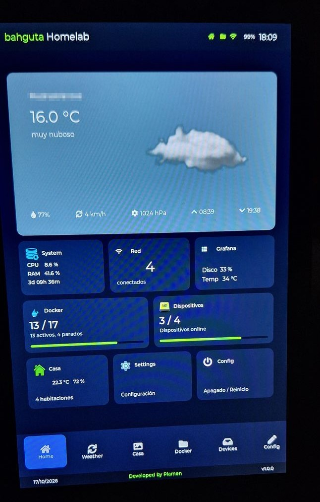
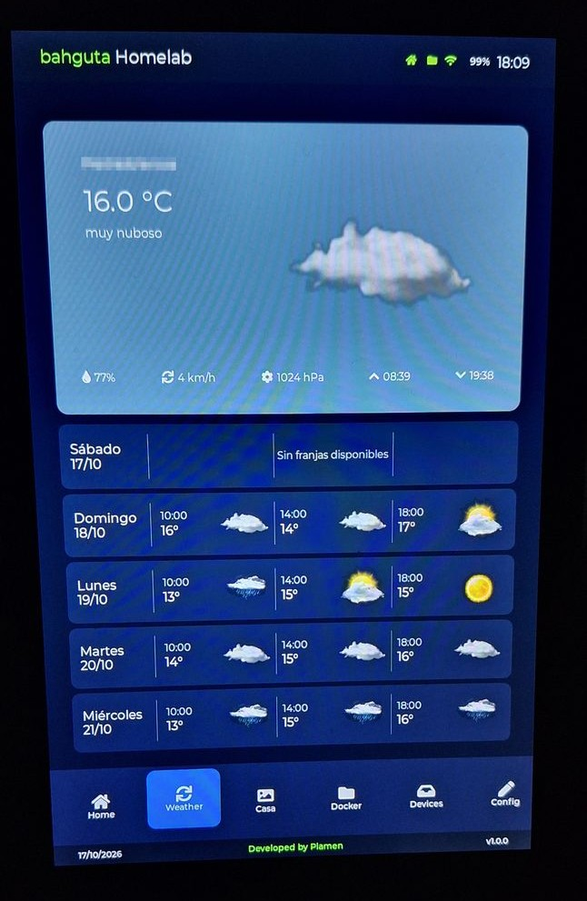
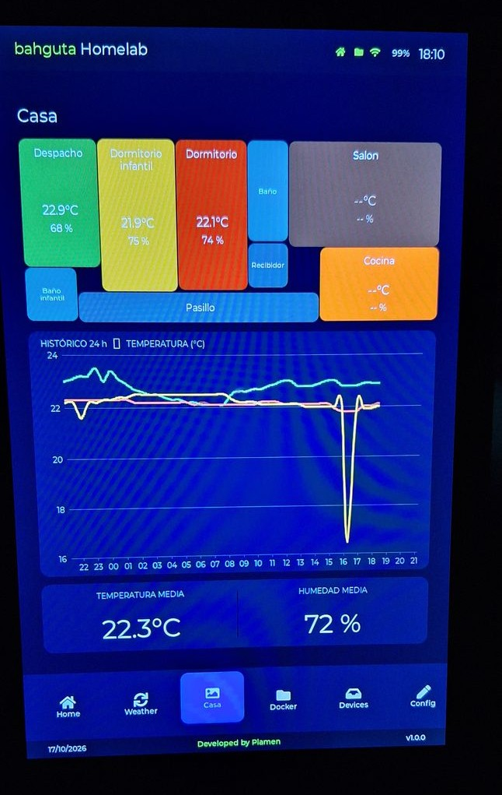
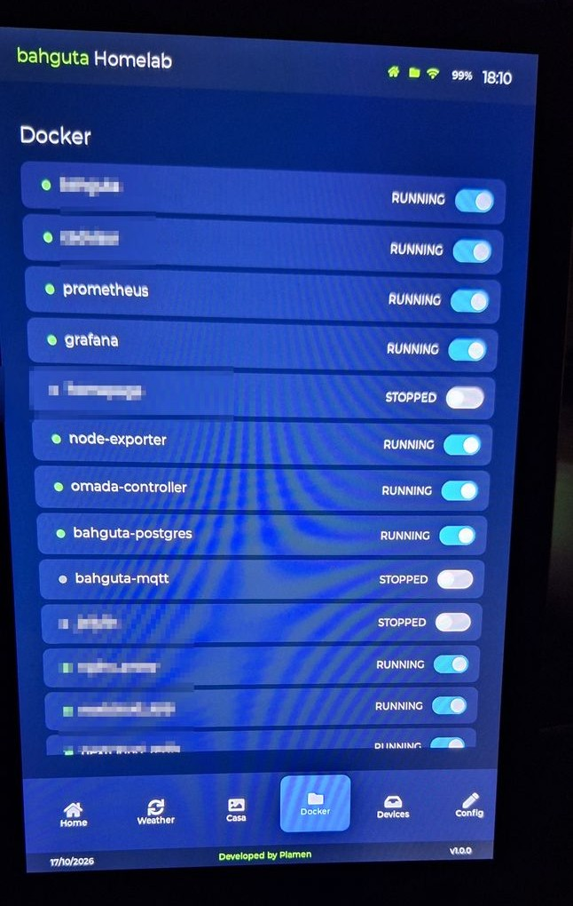
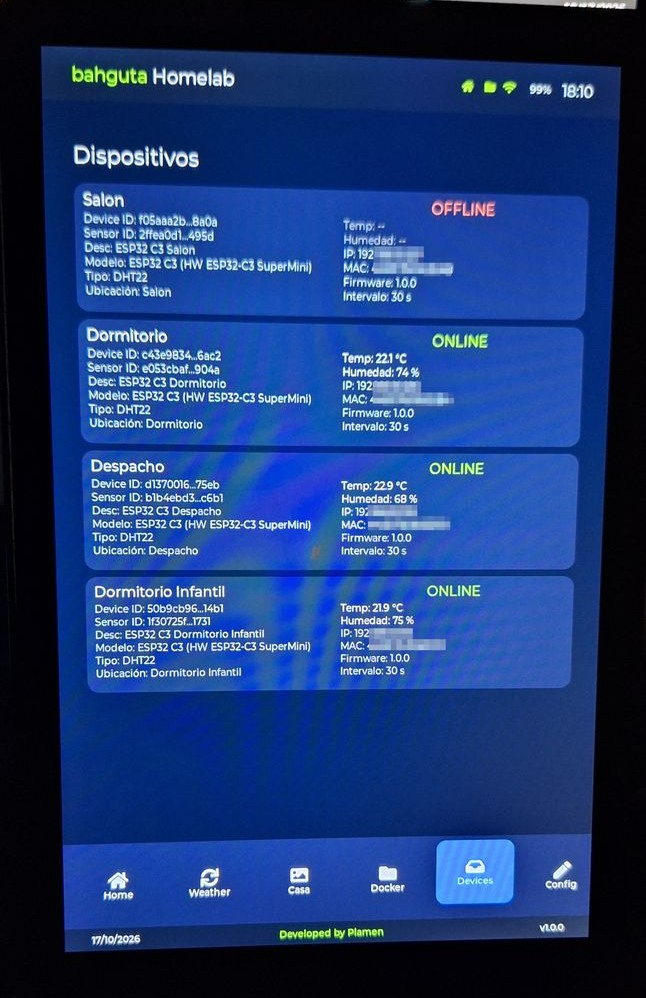
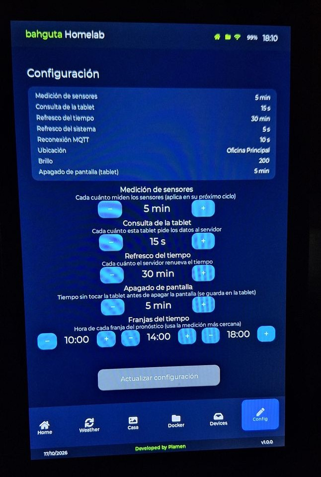
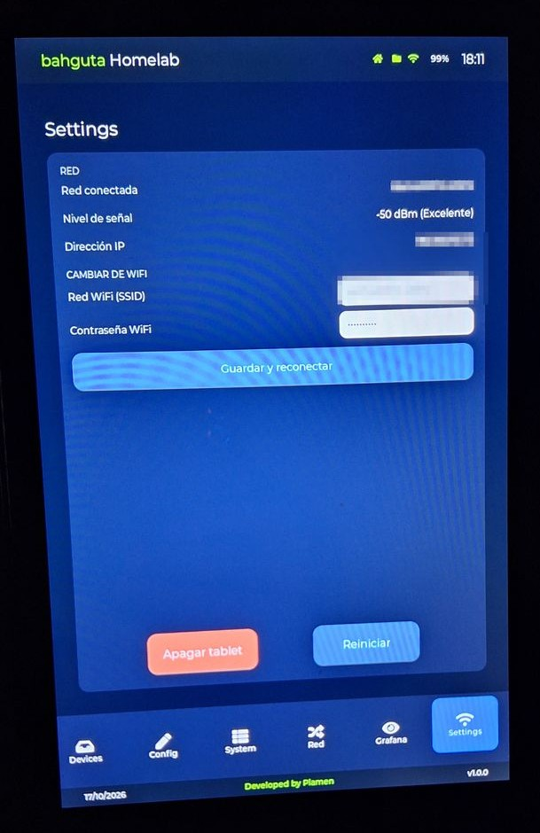
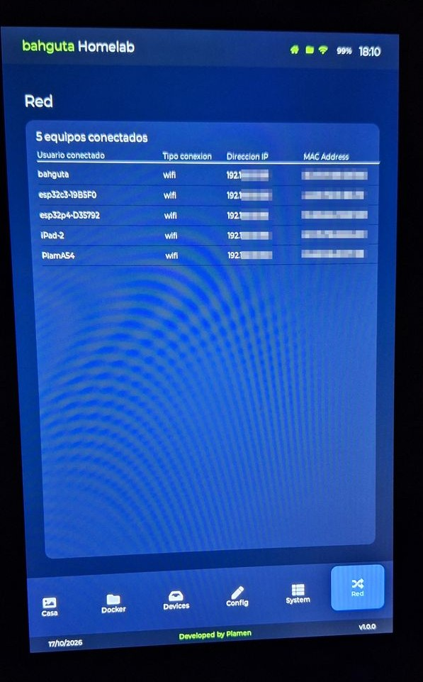
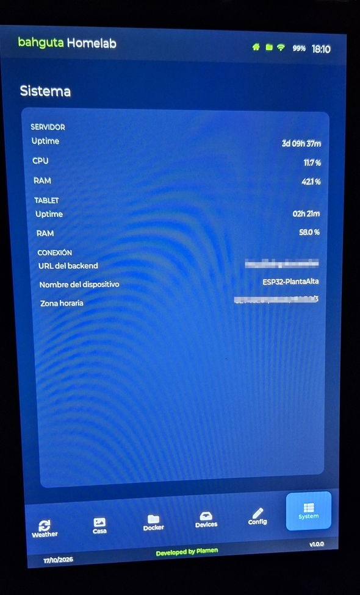
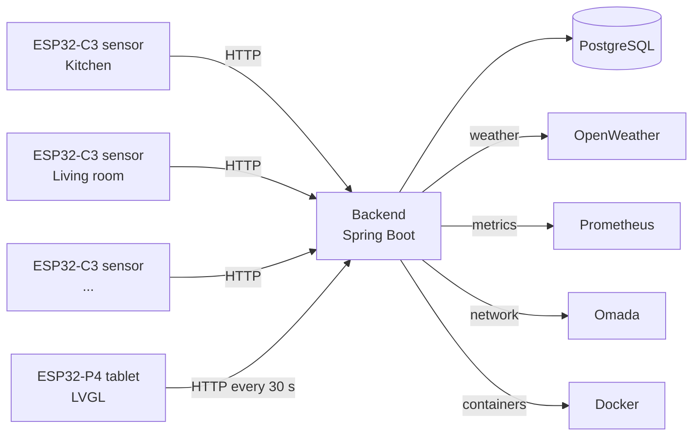

# bahguta Homelab

🇬🇧 English · 🇪🇸 [Español](README.es.md)


A control panel for your home and your homelab: an **ESP32-P4 tablet** that shows, in real time, the temperature and humidity of every room, the weather, your Docker containers, your network and more. It is fed by a **Spring Boot backend** and by battery-powered **ESP32-C3 sensors** spread around the house.

Everything runs on your local network: no cloud, and your data stays yours.

> **Status:** version 1.0.0, in daily use at my home. It is a personal project that I share with the community: use it, adapt it and improve it.

## What's inside

| Component | Folder | Description |
|---|---|---|
| Backend | [`spring/`](spring/) | REST API built with Spring Boot 3.5 (Java 21), PostgreSQL, Flyway and Swagger UI |
| Tablet | [`bahguta-display/`](bahguta-display/) | Firmware for the ESP32-P4 touch display (800x1280) with an LVGL interface |
| Sensors | [`bahguta-firmware/`](bahguta-firmware/) | Firmware for the ESP32-C3 nodes with a DHT22 sensor |
| Infrastructure | [`compose/`](compose/), [`config/`](config/) | Docker Compose for PostgreSQL (and an optional Mosquitto MQTT broker, not used yet) and its configuration |
| Utilities | [`scripts/`](scripts/) | Helper scripts: start/stop PostgreSQL and list/start/stop Docker containers |
| Documentation | [`docs/`](docs/) | Detailed guides (API, database, hardware, network, roadmap). Also in [Spanish](docs/es/README.md) |

## What the tablet does

- **House:** floor plan with the temperature and humidity of each room, plus a history chart with one line per room.
- **Weather:** current weather and a forecast by time slots, with animated icons (OpenWeather).
- **Devices and sensors:** status of every node and when it last sent a measurement.
- **Docker:** the server's containers, with start and stop from the tablet.
- **Network and Grafana:** shortcuts to, and status of, your network and monitoring dashboards.
- **System:** server status.
- **Settings:** WiFi, backend URL, time zone, refresh interval and inactivity timeout, stored in the tablet's own memory.
- Smooth transitions between screens and a gradual fade of the backlight when it sleeps and wakes up.
- Shows the project version reported by the backend.


Home Screen:




Weather Screen:




Casa Screen:




Docker Screen:




Devices Screen:




Config Screen:




Settings Screen:




Red Screen:




System Screen:




## Architecture



- The **sensors** measure temperature and humidity, register themselves with the backend and send their measurements over HTTP. They run on 18650 batteries and sleep between measurements to save power.
- The **backend** stores the measurements, manages devices and sensors, and aggregates everything into a single dashboard JSON.
- The **tablet** polls that dashboard periodically and draws the interface.

## Hardware

- **Tablet:** ESP32-P4 board with an 800x1280 display and a GSL3680 touch controller. Requires the Arduino core for ESP32 **v3.1**.
- **Sensors:** ESP32-C3 SuperMini with a DHT22 sensor (temperature and humidity), powered by 18650 batteries.
- **Server:** any Linux machine with Docker (in my case, a mini PC).

Parts list with links, where I bought everything and a photo of a finished node: [docs/HARDWARE.md](docs/HARDWARE.md).


## Getting started

### 1. Backend

Requirements: Docker with Compose, Java 21 and Maven.

```bash
# 1. Environment variables
cd spring
cp .env.example .env
nano .env                       # DB password, OpenWeather API key, city...

# API key for the Docker endpoints (the tablet needs the same value, see step 3)
echo "BAHGUTA_API_KEY=$(openssl rand -hex 32)" >> .env
docker ps --format '{{.Names}}' # choose which containers can be started/stopped, then add
                                # DOCKER_ALLOWED=name1,name2 to .env (comma-separated, no spaces)

# 2. Docker network and PostgreSQL
docker network create web       # first time only
mkdir -p ../data/postgres
cp ../config/postgres/.env.example ../config/postgres/.env
docker compose -f ../compose/postgres.yml up -d

# 3. Build and deploy
bash make-proxy-template.sh     # Docker proxy template (first time, and after updating its image)
mvn -f bahguta-api/pom.xml clean package -Dmaven.test.skip=true
cp bahguta-api/target/bahguta-api-*.jar bahguta-api.jar
docker compose up -d --build
```

The API documentation (Swagger UI) is available at `http://YOUR_SERVER:8080/swagger`.

PostgreSQL and the backend share the external Docker network `web`, which is how the backend resolves the hostname `postgres`. `DB_PASSWORD` must match `POSTGRES_PASSWORD` in `config/postgres/.env` (template in `config/postgres/.env.example`).

### Environment variables

| Variable | Description | Default |
|---|---|---|
| `DB_PASSWORD` | PostgreSQL password (**required**) | - |
| `DB_USER` | PostgreSQL user | `bahguta` |
| `DB_URL` | JDBC URL | `jdbc:postgresql://postgres:5432/bahguta` |
| `PROMETHEUS_URL` | Prometheus URL | `http://localhost:9090` |
| `WEATHER_API_KEY` | [OpenWeather](https://openweathermap.org/api) API key | empty |
| `WEATHER_CITY` / `WEATHER_COUNTRY` | City and country for the weather | `Madrid` / `ES` |
| `OMADA_URL`, `OMADA_USERNAME`, `OMADA_API_PASSWORD` | TP-Link Omada controller (optional) | empty |
| `BAHGUTA_API_KEY` | Key required by the endpoints that start and stop containers (**required**). Generate it with `openssl rand -hex 32` | - |
| `DOCKER_ALLOWED` | Names of the containers that can be started and stopped, comma-separated without spaces (**required**) | - |

### 2. Sensors (ESP32-C3)

Requirements: [PlatformIO](https://platformio.org/).

```bash
cd bahguta-firmware/bahguta-firmware
cp include/Config.example.h include/Config.h
# edit include/Config.h: WiFi, backend URL, room name and location
pio run -t upload
```

Each sensor needs its own `Config.h` (different name, location and IP). `Config.h` is in `.gitignore`: never commit it.

### 3. Tablet (ESP32-P4)

1. Install the Arduino core for ESP32 **v3.1** and the libraries the project uses (LVGL included; see the `bahguta-display/` folder).
2. Copy `bahguta-display/bahguta_display/src/ui/Secrets.example.h` to `Secrets.h` in the same folder and set the same `BAHGUTA_API_KEY` as in the backend's `.env`. Without it, starting and stopping containers from the tablet fails with `401`.
3. Open `bahguta-display/bahguta_display/bahguta_display.ino`, then build and upload.
4. Upload the `data/` folder (weather icons and animations) to the tablet's **LittleFS** filesystem.
5. On first boot, open **Settings** and configure the WiFi and the backend URL (for example `http://bahguta.local`).

## Security: read this before exposing anything

This project is designed for a **trusted local network**:

- The API has **no general authentication**: anyone with access to the network can read its data. **Do not expose it to the internet.**
- The endpoints that start and stop containers are protected: they require the `X-API-Key` header and only act on the containers listed in `DOCKER_ALLOWED`.
- The backend does **not** mount `/var/run/docker.sock`. It talks to Docker through a proxy (`docker-proxy`) that only allows listing, starting and stopping containers, so a compromised backend cannot become administrator of the server. Details in [docs/NETWORK.md](docs/NETWORK.md#docker-containers).
- The key travels over plain HTTP: it stops other devices from calling those endpoints, but not someone sniffing your network.
- The example MQTT broker allows anonymous connections.
- Never commit your `.env`, your `Config.h`, your `Secrets.h` or any keys. The `*.example` files are the templates.

## Continuous deployment (optional)

The repository includes a `.gitlab-ci.yml` that builds the backend and deploys it with Docker Compose on the server, with automatic rollback if Spring Boot fails to start. It requires a GitLab runner with Docker access on the target machine.

## Contributing

Contributions are welcome: open an issue to discuss an idea or a bug, or send a pull request directly. Because the project is licensed under **GPL-3.0**, improvements published from it must remain free software.

## License

[GNU General Public License v3.0](LICENSE).
