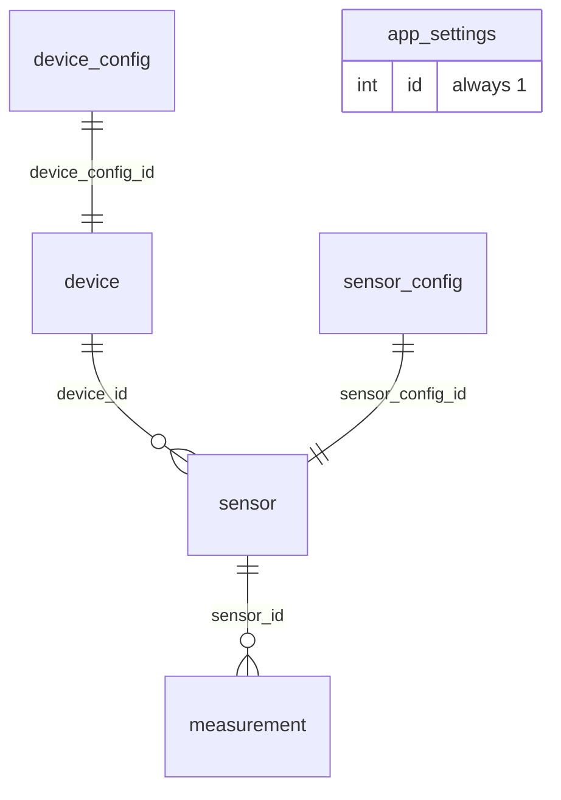

# Database

PostgreSQL 17. The schema is created and versioned by **Flyway** when the backend starts (`spring/bahguta-api/src/main/resources/db/migration`). Hibernate only validates (`ddl-auto=validate`): it never alters the tables.

## Diagram



## Tables

### `device`
A physical node (for example, the ESP32-C3 in a room).

| Column | Type | Description |
|---|---|---|
| `id` | UUID | Identifier |
| `name`, `description`, `location` | text | Name, description and room |
| `hardware_model` | text | Board model |
| `device_type` | enum | `ESP32`, `ESP32_C3`, `ESP32_S3`, `ESP32_P4`, `UNKNOWN` |
| `status` | enum | `ONLINE`, `OFFLINE`, `ERROR` |
| `enabled` | boolean | Device enabled |
| `secret_key` | text | Device key |
| `last_seen` | timestamp | Last keep-alive |
| `device_config_id` | UUID | Configuration (FK to `device_config`) |

### `device_config`
Configuration the backend hands to the device: `firmware_version`, `ip_address`, `mac_address`, `heartbeat_seconds` (how often it wakes up, measures and sleeps) and reserved MQTT fields (`mqtt_host`, `mqtt_port`, `mqtt_topic`), not used yet.

### `sensor`
A sensor belonging to a device. Deleted in cascade with its device.

| Column | Type | Description |
|---|---|---|
| `device_id` | UUID | Owning device |
| `type` | enum | `DHT11`, `DHT22`, `BME280`, `MQ2`, `SOIL`, `RAIN`, `RELAY`, `PIR`, `UNKNOWN` |
| `name` | text | Name (unique per device by convention) |
| `enabled` | boolean | Sensor enabled |
| `sensor_config_id` | UUID | Configuration (FK to `sensor_config`) |

### `sensor_config`
`enabled` and `interval` (measurement interval, in seconds) of a sensor.

### `measurement`
One measurement. Fields that do not apply to the sensor type stay `NULL`.

| Column | Type | Description |
|---|---|---|
| `sensor_id` | UUID | Sensor (deleted in cascade) |
| `temperature` | double | Temperature (°C) |
| `humidity` | double | Relative humidity (%) |
| `pressure` | double | Pressure |
| `valor` | double | Generic value for other sensors |
| `created_at` | timestamp | Time of the measurement |

Indexes on `sensor_id`, on the date and on `(sensor_id, created_at DESC)` keep "latest measurement" and history queries fast.

### `app_settings`
A single row (`id = 1`) with the application settings, which the tablet reads and edits:

| Column | Range | Description |
|---|---|---|
| `sensor_interval_seconds` | 10-3600 | Measurement interval |
| `weather_refresh_seconds` | 60-86400 | Weather refresh |
| `system_refresh_seconds` | 1-3600 | System status refresh |
| `mqtt_reconnect_seconds` | 1-600 | Reserved (MQTT unused) |
| `device_name`, `device_location` | text | Name and location of the tablet |
| `brightness` | 0-255 | Brightness |
| `screen_always_on`, `screen_timeout_seconds` | boolean, 0-86400 | Screen always on, or inactivity timeout |
| `forecast_hour_1/2/3` | 0-23 | Reference hours of the forecast time slots (default 9, 14 and 19) |

Migration `V2` inserts an initial row with example values (`device_name = 'ESP32-PlantaAlta'`, `device_location = 'Oficina Principal'`); change them from the tablet or with an `UPDATE`.

## Migrations

| Version | Content |
|---|---|
| `V1__Initial_schema` | Enums, `device`, `device_config`, `sensor`, `sensor_config` and `measurement` |
| `V2__Add_settings_table` | `app_settings` table with a default row |
| `V3__Add_forecast_hours` | `forecast_hour_1/2/3` columns |

To change the schema, **never edit** a migration that has already been applied: create a new one (`V4__...sql`).

## Backups

There is no backup script yet. PostgreSQL data lives in `data/postgres` (outside Git). A manual backup and restore:

```bash
# backup
docker compose -f compose/postgres.yml exec -T postgres pg_dump -U bahguta bahguta > backup.sql

# restore (into an empty database)
docker compose -f compose/postgres.yml exec -T postgres psql -U bahguta bahguta < backup.sql
```
