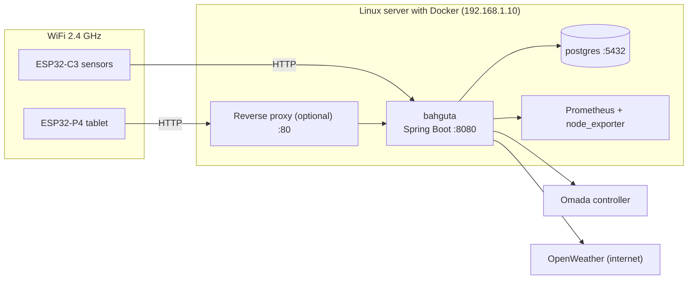

# Network and integrations

This guide explains how the components connect to each other and what your network needs. All names, addresses and keys in the examples are **fictitious**: replace them with your own.

## Overview



## WiFi connectivity

- **ESP32-C3 boards only support 2.4 GHz WiFi.** If your router splits the bands, use the 2.4 GHz one (or a dedicated 2.4 GHz IoT network).
- Tablet and sensors only need to reach the backend over HTTP. They do not need internet access: only the backend queries OpenWeather.
- Sensor WiFi is set in `include/Config.h` and the tablet's in its **Settings** screen. Neither is stored in the repository.
- Recommended: give the server a fixed IP (DHCP reservation) and, if you can, place it on a trusted network or VLAN.

## Docker network

PostgreSQL and the backend share an external Docker network called `web`, created once:

```bash
docker network create web
```

| Container | Hostname | Port | Used by |
|---|---|---|---|
| `bahguta` (backend) | `bahguta` | 8080 | Tablet and sensors |
| `bahguta-postgres` | `postgres` | 5432 (inside Docker only) | Backend |
| `bahguta-mqtt` (optional, **unused**) | `mqtt` | 1883 | Nobody for now |

PostgreSQL **does not publish a port** to the outside: it is only reachable from containers on the `web` network. Keep it that way.

## Addresses used by tablet and sensors

The backend URL is configured here:

- **Tablet:** **Settings** screen → backend URL. The default is `http://bahguta.local`, with no port, meaning port **80**.
- **Sensors:** `BACKEND_URL` and `API_BASE_URL` in `include/Config.h`.

You have two options:

1. **Straight to port 8080:** use `http://192.168.1.10:8080` (your server's IP) on tablet and sensors.
2. **Behind a reverse proxy** (Nginx, Traefik, Caddy...) listening on 80 and forwarding to the backend. Then you can use a name such as `http://bahguta.example.lan`, created in your router's DNS or in your local DNS server.

With option 1, remember to include `:8080`.

## Integrations

### Prometheus and node_exporter (server metrics)

Server status (CPU, memory, temperature, disks) comes from Prometheus.

```env
PROMETHEUS_URL=http://prometheus.example.lan:9090
```

You need Prometheus scraping [node_exporter](https://github.com/prometheus/node_exporter). The disks that are displayed are configured in `application.properties` under the `bahguta.grafana` prefix:

| Property | Description | Example |
|---|---|---|
| `bahguta.grafana.root-mount` | Mount point of the system disk | `/` |
| `bahguta.grafana.root-device` | Part of the device name | `ubuntu--lv` |
| `bahguta.grafana.storage-mount` | Mount point of the data disk | `/srv/storage` |
| `bahguta.grafana.storage-device` | Part of the device name | `sda1` |
| `bahguta.grafana.temp-query` | Temperature query (optional) | `node_hwmon_temp_celsius` |

You can also set them with environment variables (for example `GRAFANA_STORAGE_MOUNT`). If you run node_exporter in Docker, remember to mount the host filesystem so it sees the real disks.

### Omada (network clients)

If you use a TP-Link Omada controller, the backend queries the connected clients:

```env
OMADA_URL=https://omada.example.lan
OMADA_USERNAME=bahguta-api
OMADA_API_PASSWORD=change-me
OMADA_INSECURE_TLS=false
```

- Create a **dedicated** Omada user with read-only permissions; do not reuse an administrator password.
- Set `OMADA_INSECURE_TLS=true` only if the controller uses a self-signed certificate. Ideally, install a valid certificate.
- The `bahguta.omada.site` property selects the Omada site (empty = the first one).
- Optional: if you leave the URL empty, the network section will not be shown.

### OpenWeather (weather)

It needs a free [OpenWeather](https://openweathermap.org/api) API key and your city:

```env
WEATHER_API_KEY=your-openweather-api-key
WEATHER_CITY=Madrid
WEATHER_COUNTRY=ES
```

It is the only thing that goes out to the internet. The tablet never talks to OpenWeather directly.

### Docker (containers)

The backend lists, starts and stops containers by running the scripts in `scripts/docker/` (`list.sh`, `start.sh`, `stop.sh`) with the Docker CLI. For that, the container mounts:

```yaml
volumes:
  - /opt/bahguta/scripts:/opt/bahguta/scripts
  - /var/run/docker.sock:/var/run/docker.sock
```

> Mounting `docker.sock` is equivalent to giving the container full control of the server. Use it only on a trusted network, or remove these volumes if you do not want the feature.

## Network security recommendations

- Do not expose port 8080 or the proxy to the internet: the API has no authentication.
- If you need remote access, connect through a VPN (WireGuard, Tailscale...) to your local network.
- If your router allows it, put the sensors and the tablet on an IoT VLAN with access only to the server.
- Use different passwords for WiFi, the database and each service. Never commit `.env` or `Config.h`.

## Troubleshooting

| Symptom | What to check |
|---|---|
| The tablet shows `v--` or empty data | Backend URL in Settings (is `:8080` missing?) and `curl http://YOUR_SERVER:8080/api/v1/dashboard/data` from another machine |
| A sensor does not appear | That it is on 2.4 GHz WiFi, that the URL in `Config.h` is reachable, and the serial monitor (`pio device monitor`, 115200 baud) |
| The backend does not start | `docker logs bahguta`: usually `DB_PASSWORD` is missing or the host `postgres` does not resolve |
| "Cannot resolve `postgres`" | Backend and PostgreSQL must be on the same Docker network: `docker network inspect web` |
| Server status does not appear | `PROMETHEUS_URL` and that Prometheus has node_exporter |
| No weather | OpenWeather API key (new keys can take a while to activate) |
