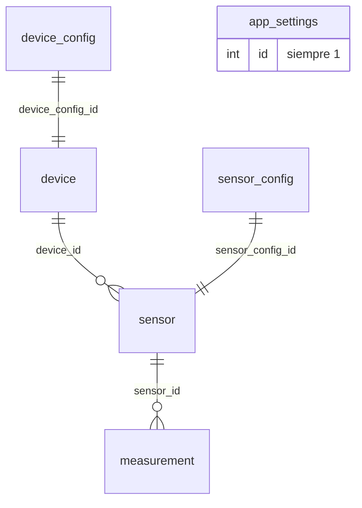

# Base de datos

PostgreSQL 17. El esquema lo crea y versiona **Flyway** al arrancar el backend (`spring/bahguta-api/src/main/resources/db/migration`). Hibernate solo valida (`ddl-auto=validate`): nunca modifica las tablas.

## Diagrama

## Tablas

### `device`
Un nodo físico (por ejemplo, el ESP32-C3 de una habitación).

| Columna | Tipo | Descripción |
|---|---|---|
| `id` | UUID | Identificador |
| `name`, `description`, `location` | texto | Nombre, descripción y habitación |
| `hardware_model` | texto | Modelo de la placa |
| `device_type` | enum | `ESP32`, `ESP32_C3`, `ESP32_S3`, `ESP32_P4`, `UNKNOWN` |
| `status` | enum | `ONLINE`, `OFFLINE`, `ERROR` |
| `enabled` | boolean | Dispositivo activo |
| `secret_key` | texto | Clave del dispositivo |
| `last_seen` | timestamp | Última señal de vida |
| `device_config_id` | UUID | Configuración (FK a `device_config`) |

### `device_config`
Configuración que el backend entrega al dispositivo: `firmware_version`, `ip_address`, `mac_address`, `heartbeat_seconds` (cada cuánto despierta, mide y duerme) y campos MQTT (`mqtt_host`, `mqtt_port`, `mqtt_topic`) reservados, aún sin uso.

### `sensor`
Un sensor de un dispositivo. Se borra en cascada con su dispositivo.

| Columna | Tipo | Descripción |
|---|---|---|
| `device_id` | UUID | Dispositivo al que pertenece |
| `type` | enum | `DHT11`, `DHT22`, `BME280`, `MQ2`, `SOIL`, `RAIN`, `RELAY`, `PIR`, `UNKNOWN` |
| `name` | texto | Nombre (único dentro del dispositivo, por convención) |
| `enabled` | boolean | Sensor activo |
| `sensor_config_id` | UUID | Configuración (FK a `sensor_config`) |

### `sensor_config`
`enabled` e `interval` (intervalo de medición, en segundos) de un sensor.

### `measurement`
Una medición. Los campos que no aplican al tipo de sensor quedan a `NULL`.

| Columna | Tipo | Descripción |
|---|---|---|
| `sensor_id` | UUID | Sensor (borrado en cascada) |
| `temperature` | double | Temperatura (°C) |
| `humidity` | double | Humedad relativa (%) |
| `pressure` | double | Presión |
| `valor` | double | Valor genérico para otros sensores |
| `created_at` | timestamp | Momento de la medición |

Índices por `sensor_id`, por fecha y por `(sensor_id, created_at DESC)` para que las consultas de "última medición" e histórico sean rápidas.

### `app_settings`
Una única fila (`id = 1`) con los ajustes de la aplicación, que la tablet lee y edita:

| Columna | Rango | Descripción |
|---|---|---|
| `sensor_interval_seconds` | 10-3600 | Intervalo de medición |
| `weather_refresh_seconds` | 60-86400 | Refresco del tiempo |
| `system_refresh_seconds` | 1-3600 | Refresco del estado del sistema |
| `mqtt_reconnect_seconds` | 1-600 | Reservado (MQTT sin uso) |
| `device_name`, `device_location` | texto | Nombre y ubicación de la tablet |
| `brightness` | 0-255 | Brillo |
| `screen_always_on`, `screen_timeout_seconds` | boolean, 0-86400 | Pantalla siempre encendida o tiempo de inactividad |
| `forecast_hour_1/2/3` | 0-23 | Horas de referencia de las franjas de la previsión (por defecto 9, 14 y 19) |

La migración `V2` inserta una fila inicial con valores de ejemplo (`device_name = 'ESP32-PlantaAlta'`, `device_location = 'Oficina Principal'`); cámbialos desde la tablet o con un `UPDATE`.

## Migraciones

| Versión | Contenido |
|---|---|
| `V1__Initial_schema` | Enums, `device`, `device_config`, `sensor`, `sensor_config` y `measurement` |
| `V2__Add_settings_table` | Tabla `app_settings` con una fila por defecto |
| `V3__Add_forecast_hours` | Columnas `forecast_hour_1/2/3` |

Para cambiar el esquema, **no edites** una migración ya aplicada: crea una nueva (`V4__...sql`).

## Copia de seguridad

`scripts/system/backup.sh` y `restore.sh` hacen y restauran copias; los datos de PostgreSQL viven en `data/postgres` (fuera de Git).
