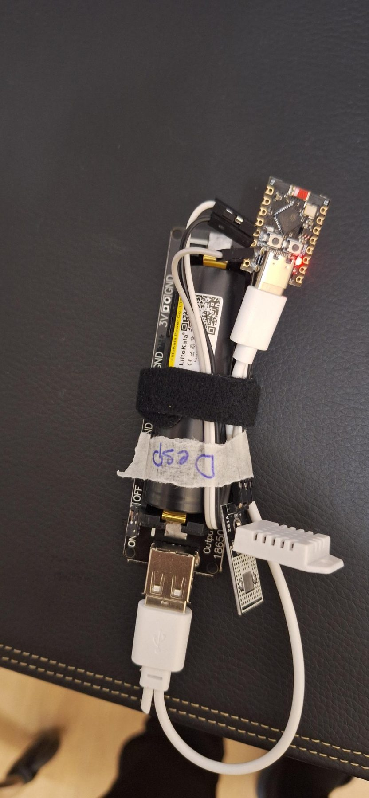

# Hardware

## Tablet (ESP32-P4)

- Placa **ESP32-P4** con pantalla táctil de **800x1280**.
- Controlador táctil **GSL3680** por I2C.
- Core de Arduino para ESP32 **v3.1**.
- Comprada en AliExpress: [placa ESP32-P4 de 10,1", táctil capacitiva, 1280x800 IPS, WiFi 6 / BT 5](https://a.aliexpress.com/_EG4yxeS).

Pines usados (`bahguta-display/bahguta_display/pins_config.h`):

| Función | GPIO |
|---|---|
| Reset de la pantalla (`LCD_RST`) | 27 |
| Retroiluminación (`LCD_LED`, PWM a 20 kHz) | 23 |
| Táctil SDA (`TP_I2C_SDA`) | 7 |
| Táctil SCL (`TP_I2C_SCL`) | 8 |
| Táctil reset (`TP_RST`) | 22 |
| Táctil interrupción (`TP_INT`) | 21 |

Los pines pueden ser distintos en otra placa con ESP32-P4: ajústalos en `pins_config.h`.

Notas:

- La retroiluminación se controla por PWM para hacer fade al apagar y encender la pantalla.
- Los iconos y animaciones del tiempo viven en `bahguta_display/data/` y se suben al sistema de ficheros **LittleFS**.

## Sensores (ESP32-C3 + DHT22)

- Placa **ESP32-C3 SuperMini** ([AliExpress, 4 MB de flash](https://a.aliexpress.com/_EzPB0eq)).
- Sensor **DHT22**, módulo AM2302 ([AliExpress](https://a.aliexpress.com/_EyuY5UI)), con la librería *DHT sensor library* de Adafruit.

Conexión:

| DHT22 | ESP32-C3 SuperMini |
|---|---|
| VCC | 3V3 |
| GND | GND |
| DATA | **GPIO 4** (con una resistencia pull-up de 10 kΩ a 3V3 si tu módulo no la lleva) |

El pin se define en `src/sensors/TemperatureSensor.h` (`DHT(4, DHT22)`).

### Funcionamiento

1. El nodo despierta, se conecta al WiFi y se registra en el backend.
2. Pide su configuración, mide y envía la medición por HTTP.
3. Entra en *deep sleep* durante `heartbeatSeconds` segundos (30 por defecto, configurable desde el backend) y repite.

Dormir entre mediciones es lo que permite que funcionen a pilas durante mucho tiempo.

### Alimentación con pila 18650

Cada nodo funciona con una pila 18650 y una placa cargadora. El problema habitual: muchas placas y power banks **apagan la salida** cuando el consumo baja de unos 30 mA durante unos 10 segundos, y el ESP32 en *deep sleep* consume muchísimo menos que eso. El nodo se quedaría sin corriente a mitad de ciclo.

Solución usada en este proyecto: una placa *Battery Shield V3* para una pila 18650 con un interruptor **NORMAL / HOLD**. En posición **HOLD** la salida se mantiene encendida hasta agotar la pila, aunque el consumo sea mínimo.

> Algunas unidades de este tipo de placas llegan con soldaduras defectuosas: comprueba cada una antes de montarla.

### Lista de materiales por nodo

| Pieza | Notas | Enlace |
|---|---|---|
| ESP32-C3 SuperMini | 4 MB de flash | [AliExpress](https://a.aliexpress.com/_EzPB0eq) |
| Módulo DHT22 / AM2302 | Resistencia pull-up de 10 kΩ si el módulo no la lleva | [AliExpress](https://a.aliexpress.com/_EyuY5UI) |
| Liitokala 18650, 3,7 V 3500 mAh (Lii-35A) | Una pila por nodo | [AliExpress](https://a.aliexpress.com/_Ew6MABu) |
| Shield 18650 **V3** (una pila, 5 V/3 A, 3 V/1 A, Type-C / Micro USB) | Lleva el interruptor ON/OFF. El anuncio también vende la V8 de dos pilas: elige la opción V3 | [AliExpress](https://a.aliexpress.com/_EwmXslG) |
| Cables, velcro o cinta, caja | | |

> No he usado la versión de dos pilas (V8): sospecho que corta la salida en deep sleep, así que este proyecto usa la V3 de una pila con interuptor ON/OFF.

Los enlaces son normales (sin afiliados); los anuncios y precios cambian, así que revisa las especificaciones antes de comprar.

### Nodo terminado

No es bonito (soldar no es lo mío), pero funciona: el nodo despierta, mide, envía la lectura y vuelve a deep sleep.

*ESP32-C3 SuperMini (arriba), la 18650 en el shield y el DHT22 a la derecha. La etiqueta indica de qué habitación es el nodo.*

## Servidor

Cualquier máquina Linux con Docker y unos 2 GB de RAM libres para el backend y PostgreSQL. En el proyecto original funciona en un [mini PC industrial sin ventilador XCY](https://a.aliexpress.com/_EJ5ZPrk) (Intel Core i5-5200U, 8 GB RAM, 128 GB SSD, doble GbE): silencioso, de bajo consumo y siempre encendido.
