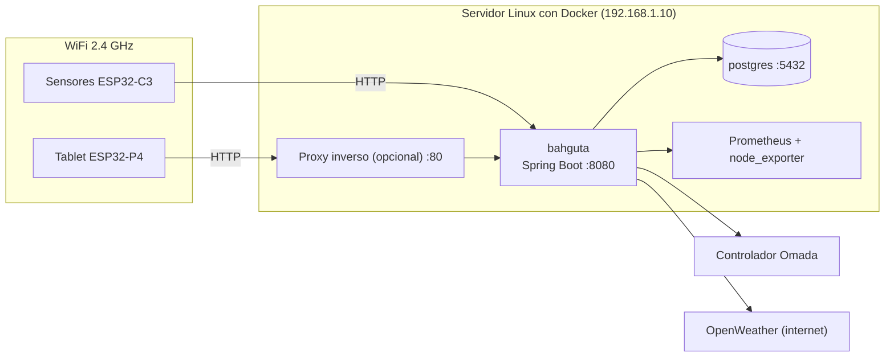

# Red e integraciones

Esta guía explica cómo se conectan entre sí los componentes y qué hace falta en tu red. Todos los nombres, direcciones y claves de los ejemplos son **ficticios**: sustitúyelos por los tuyos.

## Visión general



## Conectividad WiFi

- Los **ESP32-C3 solo soportan WiFi de 2,4 GHz**. Si tu router separa las bandas, usa la de 2,4 GHz (o una red de 2,4 GHz exclusiva para IoT).
- Tablet y sensores necesitan llegar por HTTP al backend. No necesitan salida a internet: solo el backend consulta OpenWeather.
- El WiFi de los sensores se configura en `include/Config.h` y el de la tablet en su pantalla **Ajustes**. Ninguno se guarda en el repositorio.
- Recomendado: reserva una IP fija (reserva DHCP) para el servidor y, si puedes, ponla en una VLAN o red de confianza.

## Red de Docker

PostgreSQL y el backend comparten una red externa de Docker llamada `web`, que se crea una vez:

```bash
docker network create web
```

| Contenedor | Nombre de host | Puerto | Quién lo usa |
|---|---|---|---|
| `bahguta` (backend) | `bahguta` | 8080 | Tablet y sensores |
| `bahguta-postgres` | `postgres` | 5432 (solo dentro de Docker) | Backend |
| `bahguta-mqtt` (opcional, **sin uso**) | `mqtt` | 1883 | Nadie por ahora |

PostgreSQL **no publica puerto** hacia fuera: solo es accesible desde los contenedores de la red `web`. Mantenlo así.

## Direcciones que usan tablet y sensores

La URL del backend se configura así:

- **Tablet:** pantalla **Ajustes** → URL del backend. El valor por defecto es `http://bahguta.local`, sin puerto, es decir, el **80**.
- **Sensores:** `BACKEND_URL` y `API_BASE_URL` en `include/Config.h`.

Tienes dos opciones:

1. **Directo al puerto 8080:** usa `http://192.168.1.10:8080` (la IP de tu servidor) en tablet y sensores.
2. **Detrás de un proxy inverso** (Nginx, Traefik, Caddy...) que escuche en el 80 y reenvíe al backend. Entonces puedes usar un nombre como `http://bahguta.example.lan`, creado en el DNS de tu router o en tu servidor DNS local.

Si usas la opción 1, acuérdate de poner el `:8080`.

## Integraciones

### Prometheus y node_exporter (métricas del servidor)

El estado del servidor (CPU, memoria, temperatura, discos) sale de Prometheus.

```env
PROMETHEUS_URL=http://prometheus.example.lan:9090
```

Necesitas Prometheus recogiendo [node_exporter](https://github.com/prometheus/node_exporter). Los discos que se muestran se configuran en `application.properties`, bajo el prefijo `bahguta.grafana`:

| Propiedad | Descripción | Ejemplo |
|---|---|---|
| `bahguta.grafana.root-mount` | Punto de montaje del disco del sistema | `/` |
| `bahguta.grafana.root-device` | Trozo del nombre del dispositivo | `ubuntu--lv` |
| `bahguta.grafana.storage-mount` | Punto de montaje del disco de datos | `/srv/storage` |
| `bahguta.grafana.storage-device` | Trozo del nombre del dispositivo | `sda1` |
| `bahguta.grafana.temp-query` | Consulta de temperatura (opcional) | `node_hwmon_temp_celsius` |

Puedes darles valor también con variables de entorno (por ejemplo `GRAFANA_STORAGE_MOUNT`). Si montas node_exporter en Docker, recuerda montar el sistema de ficheros del host para que vea los discos reales.

### Omada (clientes de la red)

Si usas un controlador TP-Link Omada, el backend consulta los clientes conectados:

```env
OMADA_URL=https://omada.example.lan
OMADA_USERNAME=bahguta-api
OMADA_API_PASSWORD=change-me
OMADA_INSECURE_TLS=false
```

- Crea en Omada un usuario **solo para esto**, con permisos de lectura, y no reutilices una contraseña de administrador.
- `OMADA_INSECURE_TLS=true` solo si el controlador usa un certificado autofirmado. Lo ideal es instalar un certificado válido.
- La propiedad `bahguta.omada.site` selecciona el sitio de Omada (vacío = el primero).
- Es opcional: si dejas la URL vacía, la parte de red no se mostrará.

### OpenWeather (tiempo)

Necesita una API key gratuita de [OpenWeather](https://openweathermap.org/api) y la ciudad:

```env
WEATHER_API_KEY=your-openweather-api-key
WEATHER_CITY=Madrid
WEATHER_COUNTRY=ES
```

Es lo único que sale a internet. La tablet nunca habla con OpenWeather directamente.

### Docker (contenedores)

El backend lista, arranca y para contenedores ejecutando los scripts de `scripts/docker/` (`list.sh`, `start.sh`, `stop.sh`) con la CLI de Docker. Controlar Docker es lo más delicado del proyecto, así que está protegido en tres capas (ver `spring/docker-compose.yml`).

**1. Proxy del socket de Docker.** El backend no monta `/var/run/docker.sock`. El único contenedor que ve el socket (en solo lectura) es `docker-proxy` ([tecnativa/docker-socket-proxy](https://github.com/Tecnativa/docker-socket-proxy)), que expone una API restringida en una red interna de Docker sin puertos publicados. El backend llega a él con `DOCKER_HOST=tcp://docker-proxy:2375`.

```yaml
docker-proxy:
  environment:
    CONTAINERS: 1      # listar e inspeccionar
    POST: 0            # bloquea create, exec, etc.
    ALLOW_START: 1
    ALLOW_STOP: 1
    ALLOW_RESTARTS: 1
```

Con esto el backend solo puede listar contenedores y hacer `start`, `stop` y `restart`. Crear contenedores, `exec` y el resto de la API de Docker devuelven `403`, así que un backend comprometido no puede arrancar un contenedor privilegiado y hacerse con el servidor. `/opt/bahguta/scripts` se monta en solo lectura.

> **Plantilla del proxy.** En la versión de la imagen con la que se probó, la regla que deniega todo `POST` va antes que las de `ALLOW_START` / `ALLOW_STOP`, así que con `POST=0` también se bloquean el arranque y la parada. **No** lo arregles con `POST=1`: eso permite además crear contenedores. En su lugar, ejecuta una vez `bash make-proxy-template.sh` (en `spring/`): genera `haproxy.cfg.template` con esas reglas movidas antes del bloqueo, y `docker-compose.yml` lo monta en solo lectura. Vuelve a ejecutarlo si actualizas la imagen del proxy y recrea con `docker compose up -d`.

**2. API key.** Los `POST` de `/api/v1/system/docker/` exigen la cabecera `X-API-Key` (ver [API.md](API.md#autenticación-de-los-endpoints-de-docker)). Genera la clave una vez y ponla en el `.env` junto al `docker-compose.yml`:

```bash
echo "BAHGUTA_API_KEY=$(openssl rand -hex 32)" >> .env
```

La tablet la envía desde `bahguta-display/bahguta_display/src/ui/Secrets.h` (copia `Secrets.example.h`, que es la plantilla, y usa el mismo valor). `Secrets.h` está en el `.gitignore`: nunca lo subas. La clave viaja por HTTP sin cifrar, así que te protege de que otros equipos llamen a los endpoints, no de que alguien espíe la red.

**3. Lista blanca.** Solo se pueden arrancar o parar los contenedores cuyo **nombre** esté en `DOCKER_ALLOWED` (en el `.env`, separados por comas y sin espacios); cualquier otro devuelve `403` aunque la clave sea correcta.

```bash
docker ps --format '{{.Names}}'
DOCKER_ALLOWED=grafana,prometheus
```

Deja fuera `bahguta` (si lo paras pierdes la tablet), `docker-proxy` y la base de datos. La lista usa nombres y no ids porque el id cambia al recrear un contenedor.

**Comprobar la configuración:**

```bash
docker exec bahguta docker ps                       # funciona
docker exec bahguta docker run --rm hello-world     # debe fallar con 403
docker inspect bahguta --format '{{json .Mounts}}'  # solo scripts (RW false), sin docker.sock
```

## Recomendaciones de seguridad de red

- No expongas el puerto 8080 ni el proxy a internet: salvo los endpoints de arranque y parada de Docker, la API no tiene autenticación.
- Si necesitas acceso remoto, entra por una VPN (WireGuard, Tailscale...) a tu red local.
- Si tu router lo permite, pon los sensores y la tablet en una VLAN de IoT con acceso solo al servidor.
- Usa contraseñas distintas para el WiFi, la base de datos y cada servicio. Nunca subas `.env`, `Config.h` ni `Secrets.h`.

## Solución de problemas

| Síntoma | Qué comprobar |
|---|---|
| La tablet muestra `v--` o datos vacíos | URL del backend en Ajustes (¿falta el `:8080`?) y `curl http://TU_SERVIDOR:8080/api/v1/dashboard/data` desde otro equipo |
| Un sensor no aparece | Que esté en WiFi de 2,4 GHz, que la URL de `Config.h` sea alcanzable y el monitor serie (`pio device monitor`, 115200 baudios) |
| El backend no arranca | `docker logs bahguta`: suele faltar `DB_PASSWORD` o no resolverse el host `postgres` |
| "No se resuelve `postgres`" | Backend y PostgreSQL deben estar en la misma red de Docker: `docker network inspect web` |
| El estado del servidor no aparece | `PROMETHEUS_URL` y que Prometheus tenga node_exporter |
| Sin tiempo | API key de OpenWeather (las nuevas pueden tardar un poco en activarse) |
| Arrancar o parar un contenedor devuelve `401` | `BAHGUTA_API_KEY` del `.env` del backend debe ser igual que la de `Secrets.h` de la tablet (y hay que recompilar la tablet tras cambiarla) |
| Arrancar o parar un contenedor devuelve `403` | El nombre del contenedor no está en `DOCKER_ALLOWED` (`docker ps --format '{{.Names}}'`) |
| Arrancar o parar falla y `docker logs bahguta` muestra `Request forbidden by administrative rules` | El proxy bloquea la acción: ejecuta `bash make-proxy-template.sh` y `docker compose up -d` |
